<h1 align="center">OpenKey</h1>

<p align="center">
  <strong>An open-source, local-first keyboard configurator that runs in your browser.</strong>
</p>

<p align="center">
  <a href="https://openkey-lovat.vercel.app"></a>
  <a href="LICENSE"></a>
  
  
</p>

<p align="center">
  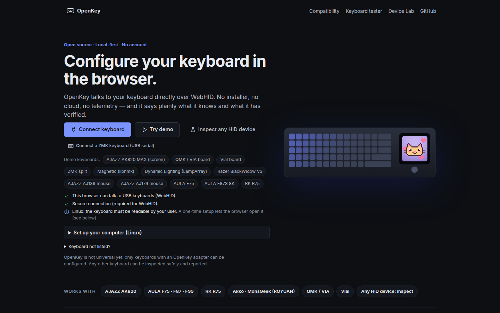
</p>

OpenKey talks to a keyboard directly over WebHID. There is no installer, no account, no server and no
telemetry: the deployment is static files, and everything you create stays in your browser. Keyboards
are supported through protocol adapters, and OpenKey says exactly what it has verified for each one.

**Live app:** https://openkey-lovat.vercel.app · **Source:** https://github.com/BakulBd/openkey ·
**Try it without hardware:** open the app and click _Try demo_.

> OpenKey is not universal yet. It configures the AJAZZ AK820 family (verified on hardware) and,
> experimentally, keyboards on 20 more protocol families: AULA, RK, ROYUAN, VIA/Vial, ZMK, libhmk,
> Razer, Wooting, Logitech, SteelSeries, EVision (Redragon …), HyperX, Ducky, A4Tech Bloody, any HID
> LampArray (Windows Dynamic Lighting) keyboard, and AJAZZ mice. Any other keyboard can be inspected
> read-only and reported so an adapter can be built. It never flashes firmware.

## Screenshots

All pictures come from the built-in demo keyboards (`pnpm screenshots`), which run the real protocol
code against a firmware simulator, so you can try every screen without hardware.

<table>
  <tr>
    <td width="50%">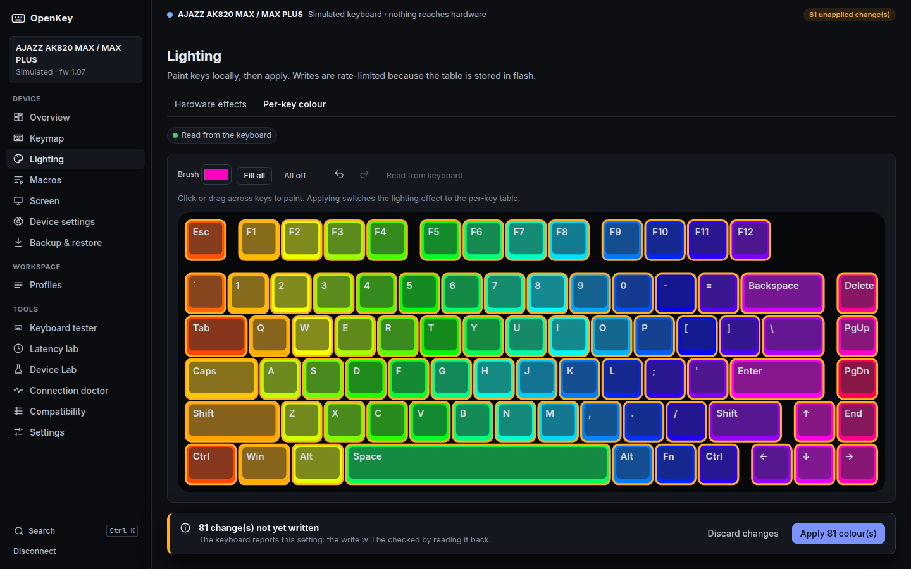<br><sub><b>Per-key lighting</b>: paint, review, then write once</sub></td>
    <td width="50%">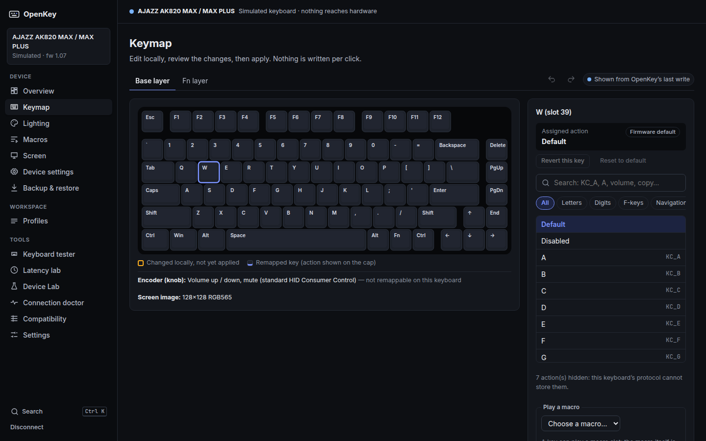<br><sub><b>Keymap studio</b>: every layer, undo, diff before apply</sub></td>
  </tr>
  <tr>
    <td>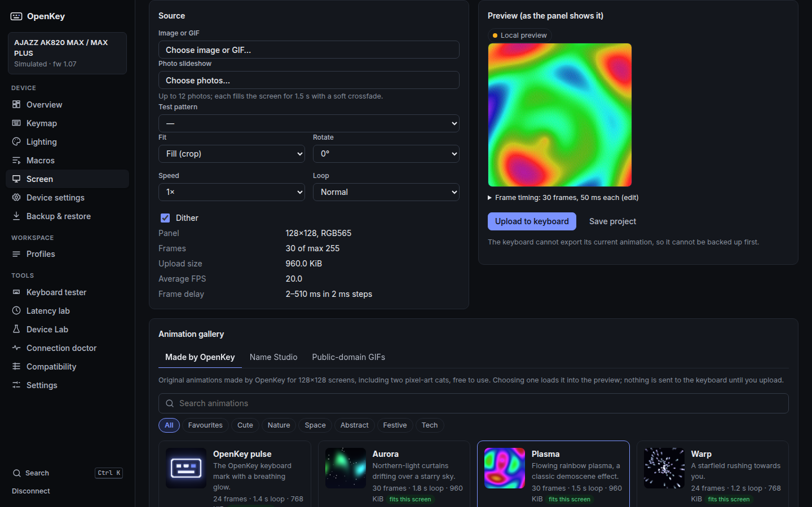<br><sub><b>Screen studio</b>: images, GIFs and a gallery for keyboard screens</sub></td>
    <td>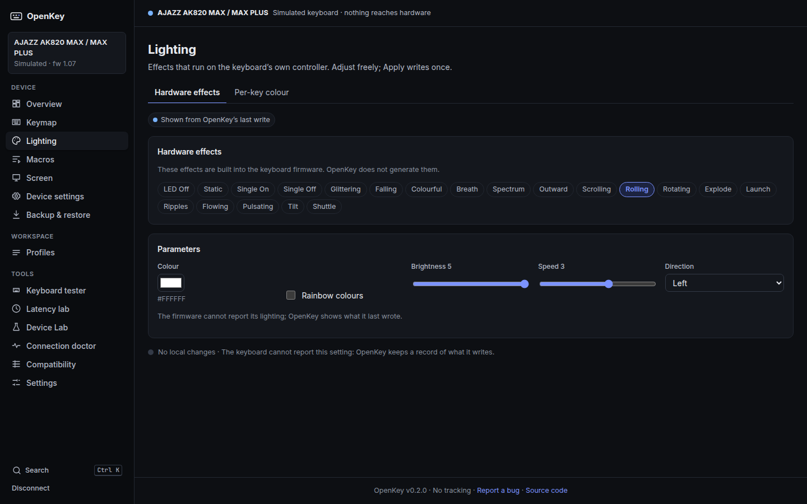<br><sub><b>Hardware effects</b>: the keyboard's own effects and settings</sub></td>
  </tr>
  <tr>
    <td>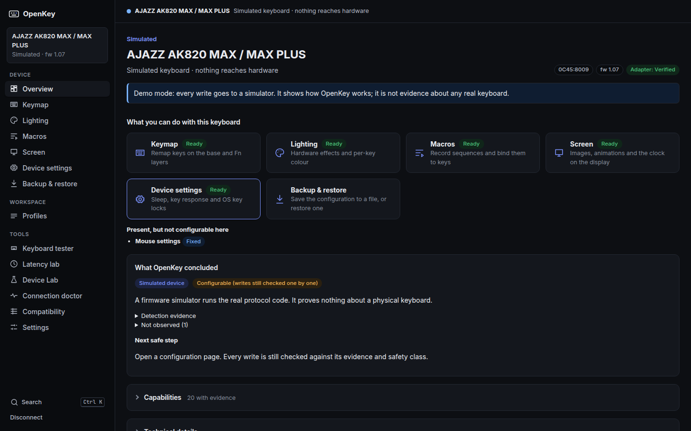<br><sub><b>Detection you can read</b>: what was matched, asked and verified</sub></td>
    <td>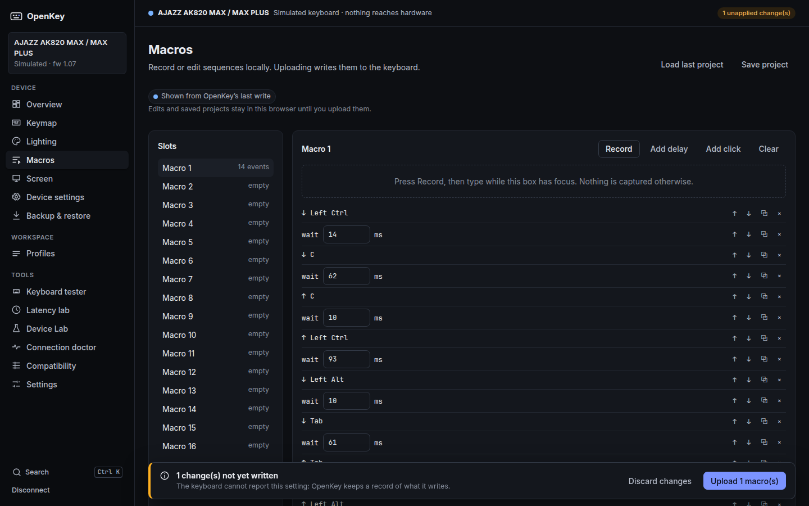<br><sub><b>Macro studio</b>: record, edit delays, bind to a key</sub></td>
  </tr>
  <tr>
    <td>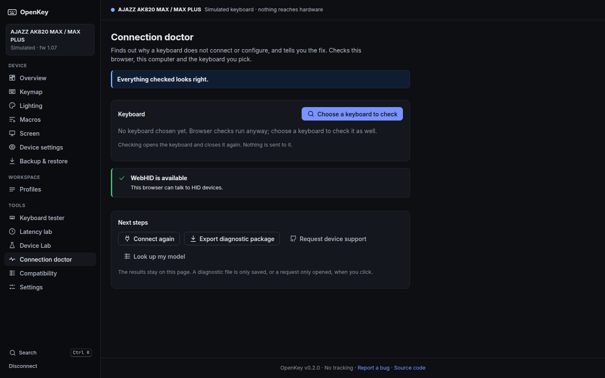<br><sub><b>Connection doctor</b>: names the fix when a keyboard will not connect</sub></td>
    <td>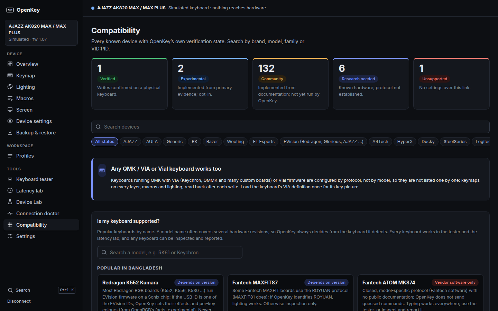<br><sub><b>Compatibility center</b>: every model with its evidence</sub></td>
  </tr>
  <tr>
    <td>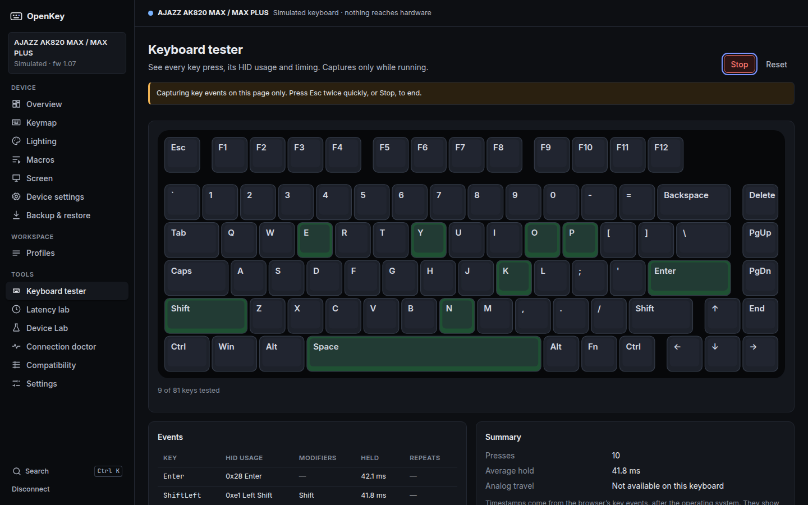<br><sub><b>Keyboard tester</b>: every switch, chatter and rollover</sub></td>
    <td>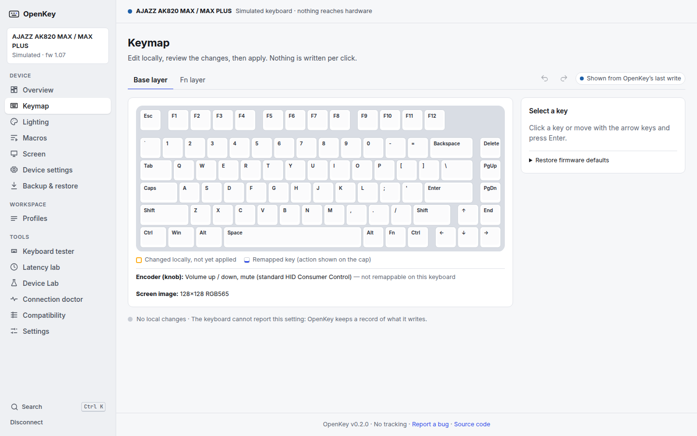<br><sub><b>Light and dark themes</b>, 11 languages, works offline</sub></td>
  </tr>
</table>

## What works today

| Area                                                                                              | State                                                                                                                                                                                                                                                                                                                                                                                                                                                                                        |
| ------------------------------------------------------------------------------------------------- | -------------------------------------------------------------------------------------------------------------------------------------------------------------------------------------------------------------------------------------------------------------------------------------------------------------------------------------------------------------------------------------------------------------------------------------------------------------------------------------------- |
| Flagship: AJAZZ AK820 MAX / MAX PLUS (TFT), `0C45:8009`                                           | **Verified on hardware** over USB: detection, handshake, per-key read, and keymap, Fn layer, macros, lighting, per-key colours, screen image and GIF upload, clock and settings writes (owner test 2026-10-11). Each write still asks for confirmation; screen uploads every time. Live per-key preview and default restore remain experimental.                                                                                                                                             |
| Other AK820 variants                                                                              | Community or research status; see the Compatibility page.                                                                                                                                                                                                                                                                                                                                                                                                                                    |
| AULA F75 / F87 / F99 / H108 (`258A:010C`), RK R75 RGB (`258A:015E`)                               | New **BY Tech** adapter (cable) and read-only **AULA receiver** adapter (2.4 GHz: model, battery, lighting). Cable: model identified by its own model code; lighting effect, colour, brightness, speed and sleep read from the keyboard and written back with a read-back check (**experimental**, from a third-party implementation verified on an F75). Unknown models of this platform (e.g. the R75) can be taught their settings layout with the keyboard's own shortcuts — reads only. |
| QMK / VIA and Vial keyboards (Keychron, GMMK, IDOBAO, KBDfans, MelGeek … 2,021 indexed from VIA)  | **VIA** adapter: keymap on every layer, knobs, layer keys, macros, QMK lighting and the definition's own **Keyboard menus**, read back after writing (experimental until verified on a physical board). The layout comes from VIA with one click, from the keyboard on **Vial** boards, from a file, or a matrix grid; layout options are applied. Vial boards also get **QMK settings, tap dance, combos and key overrides**.                                                               |
| ROYUAN boards (Akko, MonsGeek, MageGee, magnetic AJAZZ AK820 …)                                   | New **ROYUAN** adapter: identification (asked first), lighting effect, colour, brightness and speed, and key maps — read on every board, written key by key with read-back on yc500 boards (experimental). Macros and settings wait for hardware evidence.                                                                                                                                                                                                                                   |
| Royal Kludge RK61, RK68, RK84, RK87, RK100 … (78 models on RK's own list)                         | New **classic RK** adapter: lighting effect, colour, brightness, speed and sleep (write-only protocol; OpenKey shows what it last wrote). Experimental.                                                                                                                                                                                                                                                                                                                                      |
| ZMK keyboards (Corne, Sofle, Lily58 … with ZMK Studio)                                            | **ZMK Studio** over USB serial: keymap on every layer, saved and read back; the board's own Studio unlock key is required for changes.                                                                                                                                                                                                                                                                                                                                                       |
| libhmk Hall-effect keyboards                                                                      | **libhmk** adapter: keymaps, per-key actuation point and Rapid Trigger, layout read from the keyboard.                                                                                                                                                                                                                                                                                                                                                                                       |
| Razer (52 keyboards), Wooting, Logitech G915 / G815, SteelSeries Apex                             | **Experimental** lighting adapters from public sources (openrazer, Wooting’s RGB SDK, Solaar, OpenRGB facts): effects and brightness (Razer), per-key and solid colours, giving the lighting back to the keyboard; Logitech battery. Key maps and analog settings stay in the vendor apps.                                                                                                                                                                                                   |
| Any Windows Dynamic Lighting keyboard (HID LampArray)                                             | **Experimental** standards-based adapter: the lamp layout is read from the keyboard; per-key and solid colours.                                                                                                                                                                                                                                                                                                                                                                              |
| EVision boards (Redragon K552/K556 …), HyperX Alloy Origins, Ducky One 2 RGB, A4Tech Bloody B820R | **Experimental** lighting from OpenRGB facts: EVision effects and per-key colours; direct per-key colours on the others.                                                                                                                                                                                                                                                                                                                                                                     |
| AULA F87S 8K, AULA F108 Pro, AJAZZ AK680 V2 / MAX, AK992, AK35i V3 MAX, AKS075, RK M87            | **Experimental**: F87S effects and per-key with read-back (cable and receiver); F108 Pro on the AJAZZ protocol with its 240×135 screen capped at 141 frames; AK680 firmware, battery and lighting; AK992 effects; AK35i/AKS075 choose their screen size; RK M87 screen clock.                                                                                                                                                                                                                |
| FL Esports MK870, Pulsar PCMK TKL (Winbond `0416`)                                                | **Experimental**, from the official FL Esports driver: lighting (read back when the keyboard answers), per-key colours, the default layer's key map (keys, combinations, media keys, macros), 10 on-keyboard macros, sleep time, and read-only protocol checks. Owners: [test checklist](docs/FL_ESPORTS_MK870.md).                                                                                                                                                                          |
| AJAZZ mice: AJ139 V2 MC, AJ179                                                                    | **Mouse settings**: debounce, polling rate, DPI levels, sleep, lift-off, Motion Sync, Angle Snap, lighting, battery, all read back.                                                                                                                                                                                                                                                                                                                                                          |
| Not yet                                                                                           | Corsair (software lighting needs a keep-alive), most 2.4 GHz receivers (settings over radio), Bluetooth links (no settings channel), the AK820 wired single-colour (CRS `1A2C:9605`). Inspect and report them from the app; see the Compatibility page.                                                                                                                                                                                                                                      |
| Any HID device                                                                                    | Read-only inspection with an explained verdict and next safe step, sanitized diagnostic package, device-support request, offline analysis of diagnostic files.                                                                                                                                                                                                                                                                                                                               |
| Demo                                                                                              | Full UI against a firmware simulator running the real protocol code.                                                                                                                                                                                                                                                                                                                                                                                                                         |

Popular keyboards by name (Redragon, Fantech, RK, AULA, Keychron, Akko, Wooting, Razer, Logitech …):
[docs/MODEL_GUIDE.md](docs/MODEL_GUIDE.md). Every hardware revision of a model (one name often ships on
several chips) and the open-source projects found for it: [docs/RESEARCH_INVENTORY.md](docs/RESEARCH_INVENTORY.md).

Keyboard not connecting? Open **Connection doctor** in the app (or run `pnpm openkey doctor`): it checks
the browser, the operating system's permissions and the keyboard's interfaces, and names the fix. Feature-level detail with evidence: [docs/HARDWARE_TEST_MATRIX.md](docs/HARDWARE_TEST_MATRIX.md),
[docs/COMPATIBILITY.md](docs/COMPATIBILITY.md).

## How it works

```text
transport (WebHID) → device discovery (HID collections) → descriptor match → declared probe
(automatic only for identities known to accept it, otherwise after your consent) → family identified?
→ verdict → adapter → capabilities → normalized model → UI
```

- Detection never trusts VID/PID alone: `258A:010C` is used by two unrelated products.
- Every device gets a verdict — verified match, unverified firmware, strong candidate, resembles a
  family, inspection only, unknown … — with reasons, conflicting evidence, what was not observed, and
  the next safe step. A resemblance never unlocks a write: a driver exists only after the device
  answered a family-specific request.
- Every feature has a status (supported, read-only, write-only, fixed, hardware-only, research needed,
  not on this connection, unknown …) and an evidence level (VERIFIED, OBSERVED, INFERRED, HYPOTHESIS,
  UNKNOWN, NOT_TESTED).
- Every write has a safety level, goes through a diff and a confirmation, and is reported as _verified_
  only after it was read back from the device.

Details: [docs/ARCHITECTURE.md](docs/ARCHITECTURE.md).

## The app

Keymap studio (staged edits, undo/redo, searchable keycodes, diff before apply) · lighting and per-key
colour · macro studio · screen studio (images, GIFs, rotate, dither, timeline) · backup and restore with
read-back · local profiles · keyboard tester · latency lab (declared vs measured, never inferred) ·
research lab (inspector, protocol trace, report monitor, diagnostics) · compatibility center · command
palette (Ctrl/Cmd+K) · 11 languages · installable PWA that works offline.

Browser requirements: Chrome, Edge, Opera or Brave on Windows, macOS, Linux or ChromeOS for hardware
access; any modern browser (including phones) for the demo, offline analysis and tools. Windows and
macOS need no setup. On Linux the app detects a missing permission and walks you through a one-time
udev rule (downloadable installer you run yourself with `sudo`). Details:
[Windows](docs/PLATFORM_WINDOWS.md) · [macOS](docs/PLATFORM_MACOS.md) · [Linux](docs/PLATFORM_LINUX.md) ·
[browsers](docs/BROWSER_SUPPORT.md).

The screen studio includes a gallery of 27 original animations generated by OpenKey and 11
public-domain GIFs (categories, search, favourites), and Name Studio for animated names, all loaded into
the local preview with one click.

## Deploy

Static files only: Vercel (`vercel.json`), Netlify and Cloudflare Pages (generated `_headers`), Docker
(`docker build -t openkey . && docker run -p 8080:8080 openkey`, unprivileged nginx) or any web server.
Managed fleets can pre-approve OpenKey for specific keyboards with Chrome/Edge enterprise policies. See
[docs/DEPLOYMENT.md](docs/DEPLOYMENT.md).

## Privacy

No account, analytics, tracking or cloud storage. Typing is never captured outside the tester while you
run it. Diagnostic packages exclude typing, macros, keymaps and serial numbers. Read
[PRIVACY.md](PRIVACY.md).

## CLI (Linux)

```sh
pnpm openkey doctor                      # why a keyboard does not connect, with the fix
pnpm openkey detect --verbose            # prints the verdict and next safe step
pnpm openkey analyze diagnostics.json    # offline analysis, no device needed
pnpm openkey info [--read-lighting]
pnpm openkey keymap set Caps=key:ctrl F12=consumer:mute [--layer fn] --experimental
pnpm openkey rgb set --effect Static --color '#ff0000' --brightness 5 --experimental
pnpm openkey verify per-key --experimental   # guided hardware verification with read-back
pnpm openkey backup | restore backup.json --dry-run
pnpm openkey polling        # measured report cadence
```

`openak820` remains an alias. The CLI applies the same write policy as the web app: writes that are not
yet verified on hardware need `--experimental`, every write asks for confirmation (or `--yes`) and
backs up first. Handshakes for identities that are not known to accept them need
`--allow-probe <adapter>`.

## Development

```sh
pnpm install
pnpm dev        # http://localhost:5173
pnpm test       # no hardware needed: simulators, fixtures, mock HID with fault injection
pnpm lint && pnpm typecheck
pnpm build      # static site in apps/web/dist + CLI
pnpm e2e        # browser smoke test of the build with production headers
```

Deployment is static (Vercel Hobby): `vercel.json` builds `apps/web` and sets the security headers.

Repository: `packages/` (core, hid, hid-node, protocols, devices, tft), `apps/web`, `tools/` (cli,
inspector, probe, packet-diff, capture, e2e), `devices/`, `fixtures/`, `re/` (raw evidence), `tests/`,
`docs/`.

## Contributing

Add a keyboard: [docs/CONTRIBUTING_KEYBOARDS.md](docs/CONTRIBUTING_KEYBOARDS.md) · write an adapter:
[docs/ADAPTER_GUIDE.md](docs/ADAPTER_GUIDE.md) · safety rules: [docs/SAFETY_INVARIANTS.md](docs/SAFETY_INVARIANTS.md) ·
reference keyboard: [docs/AK820_INVESTIGATION.md](docs/AK820_INVESTIGATION.md) · decisions:
[docs/ARCHITECTURE_DECISION.md](docs/ARCHITECTURE_DECISION.md) · code and translations:
[CONTRIBUTING.md](CONTRIBUTING.md) · research: [docs/PROTOCOL_RESEARCH.md](docs/PROTOCOL_RESEARCH.md) ·
plan: [docs/ROADMAP.md](docs/ROADMAP.md) · security: [SECURITY.md](SECURITY.md).

If OpenKey is useful to you, a star on GitHub helps others find it.

## License

MIT ([LICENSE](LICENSE), [THIRD_PARTY.md](THIRD_PARTY.md), [docs/LICENSE_NOTES.md](docs/LICENSE_NOTES.md)).
Not affiliated with AJAZZ, AULA or any keyboard brand; names are trademarks of their owners. OpenKey does
not distribute proprietary firmware or driver binaries.
